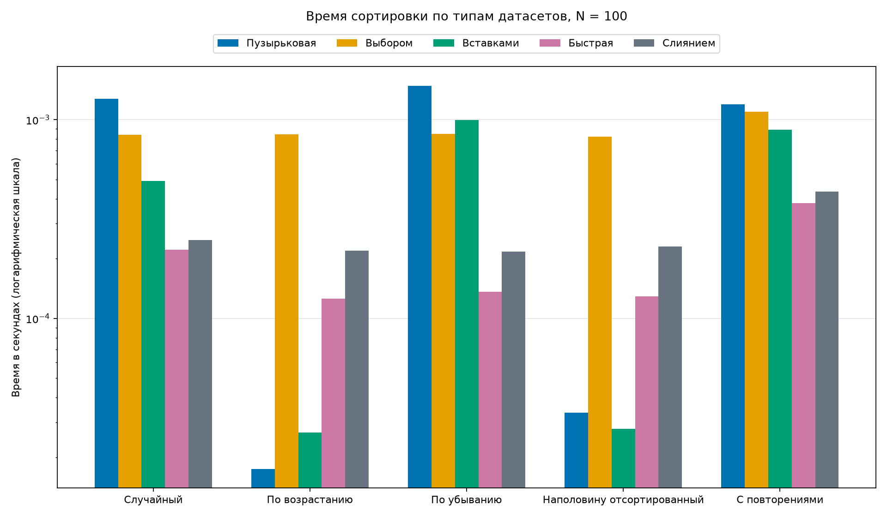
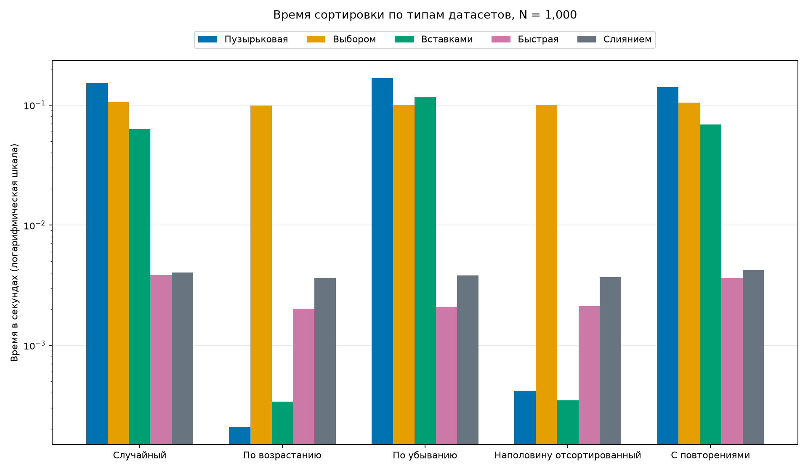
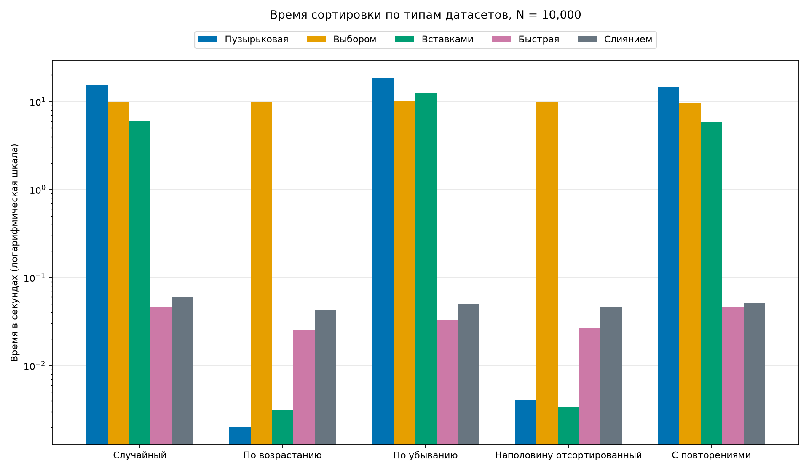
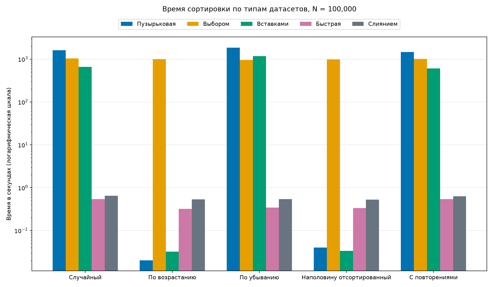

# ПР1 - Сортировки

## Запуск

```bash
uv sync
```

Запуск бенчмарка
```bash
uv run staff-sorts-bench
```

Генерация графиков из файла csv
```bash
uv run staff-sorts-bench-charts
```

---

**Цель работы:** изучить и реализовать несколько алгоритмов сортировки,
провести их сравнительный анализ по ключевым характеристикам (время
выполнения, сложность).

---

Для интерпретации результатов бенчмарка представлены теоретические оценки временной сложности алгоритмов. 
В таблице 1 приведены оценки для лучшего, среднего и худшего случаев, где N - количество элементов массива.

Таблица 1 - Теоретическая временная сложность исследуемых алгоритмов сортировки

| Алгоритм                         | Лучший случай | Средний случай | Худший случай |
|----------------------------------|---------------|----------------|---------------|
| Пузырьковая с ранним завершением | O(N)          | O(N^2)         | O(N^2)        |
| Выбором                          | O(N^2)        | O(N^2)         | O(N^2)        |
| Вставками                        | O(N)          | O(N^2)         | O(N^2)        |
| Быстрая                          | O(N log N)    | O(N log N)     | O(N^2)        |
| Слиянием                         | O(N log N)    | O(N log N)     | O(N log N)    |

---

Для наглядного сравнения времени выполнения алгоритмов построены четыре сгруппированные столбчатые диаграммы - по одной для каждого размера массива. 
По горизонтальной оси расположены типы исходных данных, по вертикальной - время выполнения в секундах. 
Каждый алгоритм обозначен постоянным цветом.

На рисунке 1 представлены результаты для массивов из 100 элементов. 



Рисунок 1 - Сравнение времени выполнения алгоритмов сортировки при N = 100

---

На рисунке 2 представлены результаты для массивов из 1000 элементов.



Рисунок 2 - Сравнение времени выполнения алгоритмов сортировки при N = 1000

---

На рисунке 3 представлены результаты для массивов из 10000 элементов. 



Рисунок 3 - Сравнение времени выполнения алгоритмов сортировки при N = 10000

---

На рисунке 4 представлены результаты для массивов из 100000 элементов. 



Рисунок 4 - Сравнение времени выполнения алгоритмов сортировки при N = 100000

---


## Ответы на вопросы

### 1 - Какой алгоритм показал лучшее время на случайных данных?

В проведенном эксперименте быстрая сортировка показала наименьшее время на случайных данных при всех исследованных размерах.

### 2 - Как влияет предварительная отсортированность данных на производительность каждого алгоритма?

Наиболее заметное ускорение наблюдается у пузырьковой сортировки и вставок. 
Пузырьковая сортировка завершает работу после первого прохода без обменов. 
Сортировка вставками на возрастающем массиве не выполняет сдвигов элементов.

При N = 100000 возрастающий массив был обработан пузырьковой сортировкой за 0,0202 с, в то время как вставками за 0,0320 с. 
На частично отсортированном массиве сортировка вставкой показала 0,0336 с, пузырьковая сортировка показала 0,0404 с. 
Такие результаты связаны с тем, что нарушения порядка в этом наборе данных ограничены обменами соседних элементов.

### 3 - Какие алгоритмы эффективны для малых и больших массивов?

Для размера N = 100 быстрая сортировка оказалась самой быстрой на случайных, 
убывающих данных и данных с повторениями. 
На возрастающих данных выиграла пузырьковая сортировка, на частично отсортированных сортировка вставками.

Для N = 100000 распределение осталось таким же.

### 4 - Совпадают ли практические результаты с теоретической сложностью алгоритмов? 

Полученные результаты согласуются с теоретическими оценками. При увеличении случайного массива с 10000 до 100000 элементов время пузырьковой сортировки существенно выросло квадратично.

Время быстрой сортировки согласуется с ростом O(N log N).

### 5 - В каких реальных задачах предпочтительнее использовать каждый из алгоритмов?

Пузырьковая сортировка удобна для изучения алгоритмов и обработки простых почти упорядоченных последовательностей. 
Сортировка выбором выполняет небольшое число обменов, что может быть полезно при высокой стоимости записи элементов. \
Вставки подходят для небольших и почти отсортированных массивов.

Быстрая сортировка эффективна для массивов в оперативной памяти. 
Слияние подходит для задач, где требуются устойчивость и гарантированная сложность O(N log N), 
при наличии дополнительной памяти.

---

**Вывод**

В работе реализованы и исследованы пять алгоритмов сортировки. 
На больших неупорядоченных массивах преимущество показали быстрая сортировка и сортировка слиянием. 
На возрастающих и почти отсортированных данных эффективными оказались пузырьковая сортировка с ранним завершением и вставки.
